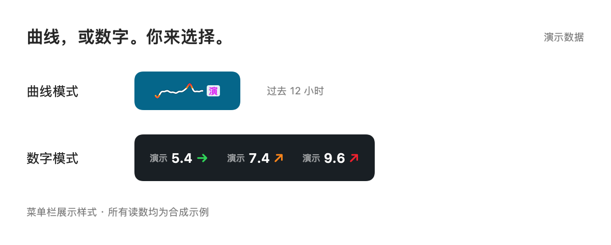
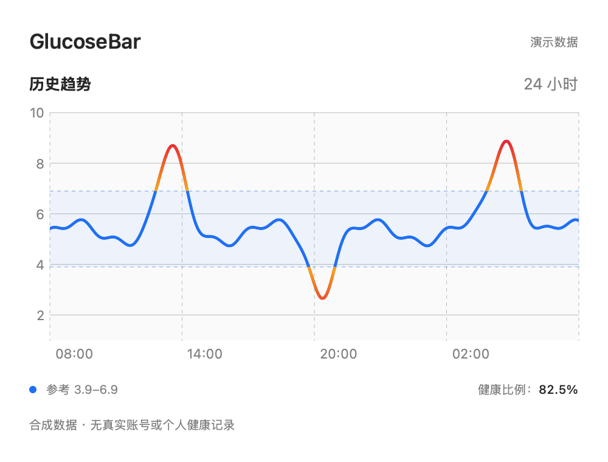

# GlucoseBar

**在 Mac 菜单栏，一眼看到血糖趋势。**

面向国内版「硅基动感」GS1 用户的原生 macOS 工具。iPhone 继续接收和上传数据，GlucoseBar 读取你本人的云端记录，在 Mac 上显示读数、趋势箭头和历史曲线。

[English](README.en.md) · [开始使用](docs/getting-started.zh-CN.md) · [隐私说明](PRIVACY.md) · [MIT 许可证](LICENSE) · [反馈问题](https://github.com/zeqiulee/glucosebar/issues/new/choose)



## 当前状态

这是早期公开测试项目。目前真实账号验证范围为 **国内版硅基动感 GS1 + iPhone**，不是厂商官方客户端。其他型号、地区、账号和系统组合尚未验证。它通过云端读取，依赖 iPhone 上传；没有实现蓝牙直连或 Apple 健康同步。

**分发状态：尚未完成 Developer ID 签名和 Apple 公证。** 当前提供源码与明确标记的未公证测试构建，不承诺下载后可在陌生 Mac 上直接打开。面向普通用户的推荐安装包会在签名、公证和另一台 Mac 验证完成后发布。[查看测试版本](https://github.com/zeqiulee/glucosebar/releases)

本工具用于辅助查看，不提供告警、诊断或治疗建议。继续使用原 App 的告警和测量时间核对；云端延迟、断网或凭证失效时，Mac 可能只显示旧记录。

## 可以做什么

- **两种菜单栏模式**：48 点宽的最近 12 小时迷你曲线，或白色读数配彩色趋势箭头；设置中随时切换。
- **展开历史趋势**：选择 3 / 6 / 12 / 24 小时，移动鼠标查看测量时刻和实际记录值。
- **连续颜色与平滑线条**：参考区间内蓝色，越界橘黄并随偏离逐渐变红；菜单栏小曲线的区间内线条为白色。超过 10 分钟的缺口断开。
- **按时长统计**：显示所选窗口内参考区间时长占比，并在悬停说明中提供有效数据覆盖率。
- **本机保存**：登录凭证放入 macOS 钥匙串；缓存绑定当前凭证。无自建服务器、广告、分析 SDK 或自动遥测。
- **先看演示**：无需提供凭证即可预览界面；演示使用合成数据，不写入真实记录缓存。



截图使用合成数据，不能用于评价任何人的血糖状况。

## 开始使用

要求 macOS 14 或以上。目前界面为中文，单位为 mmol/L。

1. 先阅读 [安装与首次连接教程](docs/getting-started.zh-CN.md)，确认设备、地区和账号适用。
2. 通过已公布的测试构建或 [源码构建](#开发与构建) 启动应用。先选「预览界面演示」了解显示方式。
3. 准备好本人硅基动感登录凭证后，在「设置」中粘贴并验证连接。此步骤目前需要在 iPhone 上使用 HTTPS 调试工具，尚未做到一键登录。
4. 对照手机上的数值和测量时间，确认数据来源正确，再用于日常辅助查看。

**不要在 Issue、聊天、截图或抓包导出里分享凭证。** 也不要为排查问题公开真实血糖记录、传感器编号或完整请求头。

## 参考区间和比例如何计算

当前固定显示 **3.9–6.9 mmol/L（含端点）**，这是本项目最初使用者选择的显示参考区间，不是对所有用户通用的健康标准；当前版本尚不支持修改它。

界面的「健康比例」实际表示：

> 所选窗口内、参考区间内的估算时长 ÷ 所选完整窗口时长 × 100%。

例如选择 24 小时，区间内有 18 小时，显示 75.0%。分母始终是完整的 24 小时。相邻有效测量按线性变化估算跨越边界的时间；超过 10 分钟的缺口、首条记录之前和末条之后不补值。**缺失时长留在分母，不算作区间内时长**，因此请同时查看悬停说明里的数据覆盖率。这不是按采样点个数统计，也不是医学健康评分。

展开图及统计窗口截至图中最新测量时间；菜单栏迷你曲线截至当前时间，固定显示过去 12 小时。记录过期时会保留旧数据状态与时间提示。

## 开发与构建

原生 SwiftUI / AppKit / Swift Charts，Swift 6.0+，macOS 14+。不依赖第三方包、数据库或本地 Web 服务。macOS 原生菜单栏交互适合使用原生技术栈。

```sh
git clone https://github.com/zeqiulee/glucosebar.git
cd glucosebar
./scripts/test-core.sh
./scripts/build-app.sh ./dist
open ./dist/GlucoseBar.app
```

仅安装 Command Line Tools 时，测试脚本使用独立检查入口；安装完整 Xcode 后也可运行 `swift test`。构建缓存可用 `GLUCOSEBAR_BUILD_DIR` 指定，架构可用 `GLUCOSEBAR_ARCH=arm64`、`x86_64` 或 `universal` 指定。交叉编译成功不等于目标硬件已验证。

CI 对代码进行检查、测试和两种架构构建。版本标签生成 **草稿预发布**，由维护者检查后决定是否公开，不能把 CI 构建成功当作签名公证或安装验证。参见 [维护与发布](docs/releasing.zh-CN.md)。

## 帮忙改进

优先欢迎：新 Mac 安装验证、首次连接体验、断网/过期状态复现、可访问性和文档改进。提交时只提供版本、系统、芯片和已脱敏的复现步骤。[贡献说明](CONTRIBUTING.md) · [安全问题](SECURITY.md) · [计划](ROADMAP.md)

如果项目对你有帮助，可以 Star 便于找到；想收到新版本通知，可以在 GitHub 的 Watch 中选择 Releases。实际试用反馈比 Star 数更有助于改进应用。

## 来源与致谢

云端接口根据社区对现有 App 的公开研究独立实现，不是厂商承诺的开放 API，可能随服务端变化失效；没有从下列项目复制实现代码：

- [nightscout-sisensingcgm-uploader](https://github.com/ImLovinIt/nightscout-sisensingcgm-uploader)：国内接口及 iOS 凭证流程参考。
- [HTTP Catcher 官方文档](https://docs.httpcatcher.com/quickstart)、[Apple 手动信任证书说明](https://support.apple.com/zh-cn/102390)：了解调试工具的配置和清理。

GlucoseBar 与硅基仿生、Apple 无隶属或背书关系。

## 许可证

[MIT](LICENSE) © 2026 zeqiulee。欢迎使用、修改与贡献；分发时保留许可证与版权声明。
